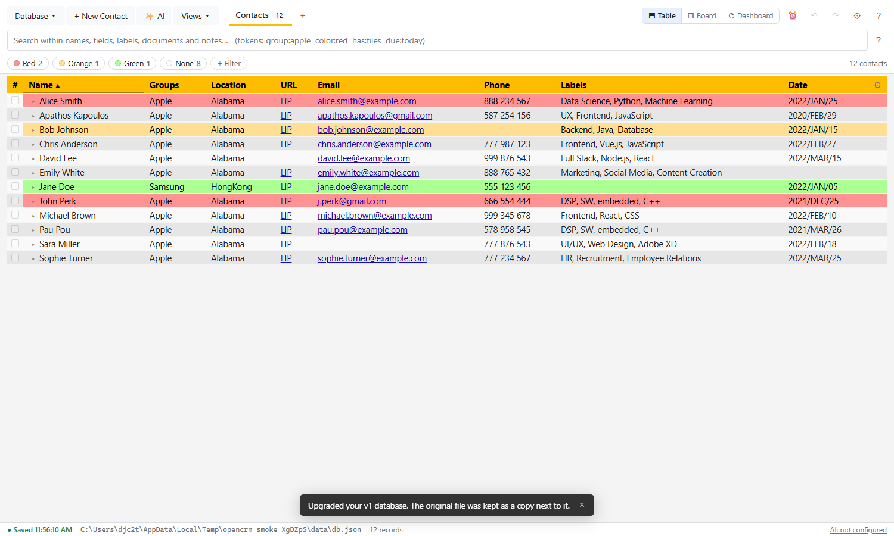
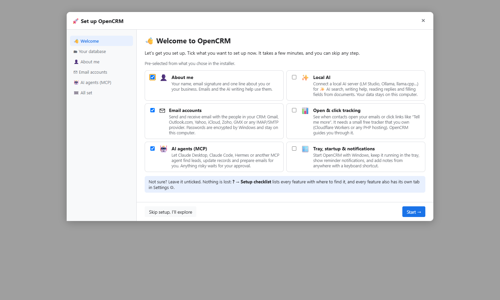
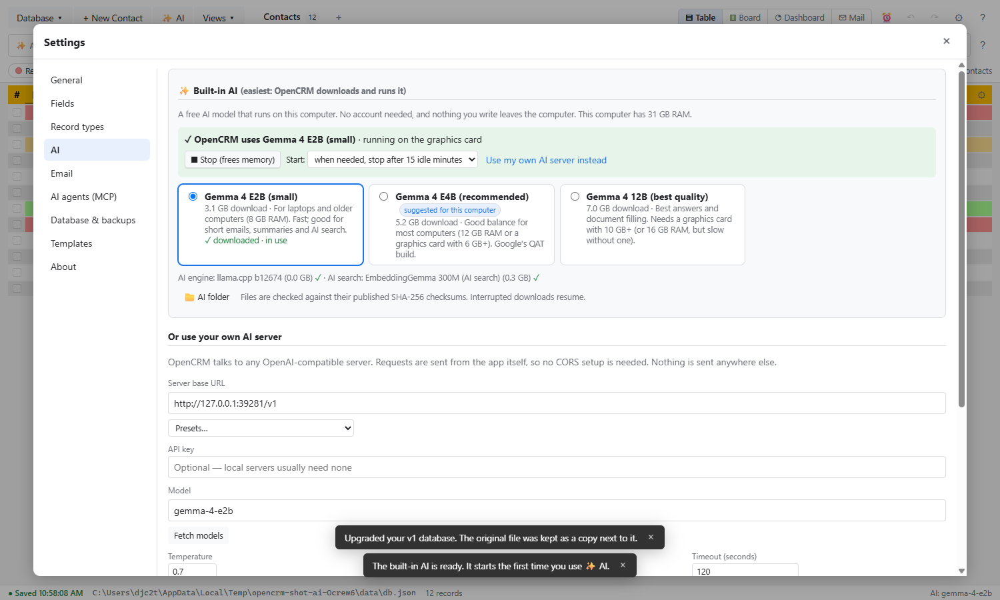
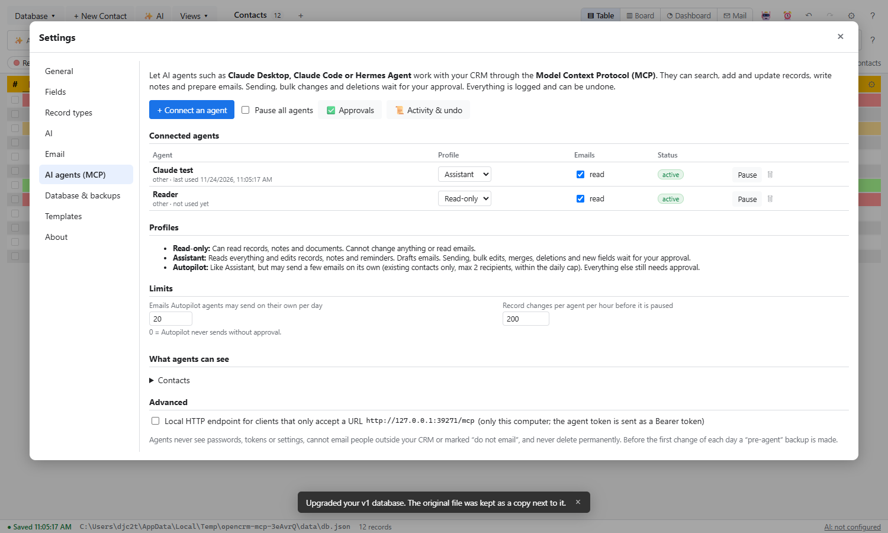

# OpenCRM (Modern)

A local-first, schema-driven desktop CRM for solopreneurs. Your data is one plain JSON file you own. Nothing leaves your computer except requests to the local AI server you configure.



**New here?** Follow the step-by-step **[tutorial](docs/TUTORIAL.md)**: one short exercise per feature, from the first start to email tracking.

## Start it

| How | What to double-click |
|---|---|
| **Installed (recommended)** | Run `dist\OpenCRM-Setup-2.0.0.exe` once. Its **Choose features** page asks for a desktop shortcut, *Start with Windows* (in the tray), and which features to set up when OpenCRM first opens. |
| **Portable folder (take it with you)** | Unzip `dist\OpenCRM-Portable-2.0.0.zip`, or copy `dist\OpenCRM-Portable\`, to a USB stick or any folder, then double-click `OpenCRM.exe`. Everything stays inside the folder: databases, settings and the built-in AI (engine and AI-search model included). |
| **Portable single file** | `dist\OpenCRM-2.0.0-portable.exe`. It keeps its data in an `OpenCRM-data` folder next to itself and downloads the AI engine when you first use it. It starts a little slower. |
| **From source** | `Start OpenCRM.cmd`. The first run installs dependencies. |

The app is not code-signed, so Windows SmartScreen may say "Windows protected your PC" the first time. Click **More info → Run anyway**.

**First launch: the setup guide.** A short guide opens. Tick what you want to set up now (it's pre-selected from the installer), then follow the steps:
1. your database (new from a template, or your old `db.json`)
2. About me
3. Local AI
4. Email accounts
5. Open & click tracking
6. AI agents (MCP)
7. Tray, startup & notifications

**Skip for now** works on every step. Each step tells you where that feature lives in Settings, and the last page lists everything you skipped with its location and a **Set up now** button.

**Later:**
- **? → Setup checklist** shows every feature as set up ✅, skipped ⏭ or not chosen ○, with where to find it.
- The status bar shows **🚀 Setup: N left** while something you chose isn't set up. You can hide it from the checklist.
- **? → Setup guide…** runs the whole guide again.
- **? → Tutorial** opens the full tutorial inside the app.

**Every later launch** reopens the same database automatically.



## Saving: there is no Save button

- Every change is written to disk about 1 second after you stop editing. It is also written every 15 s if anything is pending, and on close, sleep and Windows logout.
- Writes are atomic (temporary file, flush, then rename), so a crash or power cut cannot corrupt the database.
- **Backups:** a `backups\` folder next to the database keeps one snapshot per hour while you work (the last 48) and one per day (the last 30). To restore one, use **Database ▾ → Backups…**.
- **Attachments:** they live in `<db-name>.files\` next to the database. Removed files go to `.files\.trash`.
- If the file changes outside the app (OneDrive or Dropbox sync, a text editor), the app reloads it automatically. If you also have unsaved edits, it asks which version to keep.
- Opening a v1 database upgrades it, and the untouched original is kept as `db.v1-original.json`.
- **Database ▾ → Move / save as…** changes where the database lives.

## Everything is a field

- Fields are defined in the database itself. **+ Add field** (in a card, or in **Settings → Fields**) lets you choose:
  - Text, Long text, **Markdown**, **Dropdown (select)**, Multi-select, Tags, URL, Email, Phone, Date, Number, Checkbox, **Relation**, Files.
- **Dropdown fields** store plain text. The app draws a dropdown from the option list, and each option can have a color. Renaming an option can update every record that uses it. Deleting an option asks what to replace it with. Values not in the list are marked ⚠, with a one-click **Add to options**. Converting an existing text field to a dropdown proposes the values already in use.
- **Markdown fields** (Info, plus any you add, such as Resume or Contract) appear as tiles in the card. Click one to read formatted text (CommonMark + GFM: tables, task lists, code). Click **Edit** to change the markdown, with an optional live preview.
- **Record types:** besides Contacts, you can add Companies, Deals, Projects or anything else, each with its own fields. Link them with a **Relation** field; the other side shows the link under "Linked from".

## The main view

- **Table:** sort by any column (Shift+click adds a secondary sort). Drag column headers to reorder them, drag a header's edge to resize it, and use ⚙ or right-click to choose columns. Click ▸ to expand a preview, and Ctrl+click to multi-select.
- **Board:** a Kanban board grouped by any dropdown field. Drag a card to change its value.
- **Dashboard:** priority colors, dropdown breakdowns, reminders, stale records, activity, and recent edits.
- **Filter chips** cover colors, due reminders and every dropdown field. **+ Filter** adds any other field.
- **Saved views** remember search, filters, sort, columns and mode. You can pin a view as a tab.

### Note wildcards (unchanged from v1)

| Write in a note | Effect |
|---|---|
| `#red` `#orange` `#green` | Colors the row. Red beats orange beats green across all notes. "Latest wins" is available in Settings. |
| `#!` | Important note, pinned on top and shown in orange |
| `#X` | Hidden note |

**Set colour** (right-click a row) replaces older color tags for you.

### Search tokens
`group:apple` `label:c++` `stage:offer` `color:red` `has:files` `has:reminder` `due:today` `-label:java` `"exact phrase"`

## Taking OpenCRM to another computer (portable)

The portable folder works without installing anything.
- **Inside the folder:** OpenCRM.exe, its runtime, the docs, the tracker files, and `OpenCRM-data\`.
- **In `OpenCRM-data\`:** `Databases`, `settings`, and `ai`, which holds the llama.cpp engine and the models.

**How it works:**
- A `portable.flag` file next to OpenCRM.exe switches portable mode on. The single-file exe always runs portable.
- Database paths inside the folder are saved relative to it, so a different drive letter doesn't matter.
- Nothing is written to `%APPDATA%` or Documents.

**On a new computer:**
- **Email passwords:** Windows encrypts saved passwords per computer and user, so OpenCRM asks you to enter them again. It explains this instead of failing to sign in. Passwords are never stored readable on the stick.
- **AI agents:** they remember the path to OpenCRM.exe, so reconnect them if the drive letter changed.
- **Start with Windows:** available only in the installed version.

**Build it:**
- `npm run portable` creates the folder and the zip.
- `npm run portable -- --model gemma-4-e4b` also bundles a chat model, so all AI features work offline from the first start.

## Local AI

**Easiest: Built-in AI.** Go to **Settings → AI → Built-in AI** (also in the setup guide), pick a model, then click **Download & use**:

| Model | Download | For |
|---|---|---|
| Gemma 4 E2B | 3.1 GB | Laptops and older computers (8 GB RAM) |
| Gemma 4 E4B (recommended) | 5.2 GB | Most computers (12 GB RAM, or a graphics card with 6 GB+) |
| Gemma 4 12B | 7.0 GB | Best quality (a graphics card with 10 GB+) |

**What gets downloaded:**
- The llama.cpp engine (Vulkan build, 39 MB). It uses NVIDIA, AMD or Intel graphics, or the processor if there's no usable graphics card.
- EmbeddingGemma (0.3 GB) for fast AI search.
- Every file is pinned to an exact version and checked against its published SHA-256. Interrupted downloads resume.

**How it runs:**
- OpenCRM runs it on `127.0.0.1:39281` (chat) and `39282` (search). These are different ports from LM Studio, Ollama or your own llama.cpp, so they don't clash.
- **Start:** *when needed*, the default, starts it on the first ✨ request and stops it after 15 idle minutes to free memory. You can also choose *with OpenCRM* or *only with the Start button*.
- If the graphics card can't load the model, it falls back to the processor.
- *Use my own AI server instead* restores your previous settings.



**Or use your own server:**
1. Start a local OpenAI-compatible server:
   - **LM Studio:** Developer → Start server, on port 1234.
   - **Ollama:** `ollama pull llama3.1`, on port 11434.
2. Go to **Settings → AI → Or use your own AI server**, pick a preset, click **Fetch models**, then **Test connection**. CORS needs no setup, because requests are sent by the app itself.
3. In a card, click **✨ AI**:
   1. Pick a saved prompt or write your own. Words like `{{goal}}` become input boxes.
   2. Tick the context to include: any field, any markdown document, and each note individually. **Preview…** shows exactly what will be sent.
   3. Click **Send**. The answer streams in. You can **Copy** it, **Save as note**, **Save into field**, **Regenerate**, or **Refine** it ("shorter", "in Spanish"…).
   - With several rows selected, the same prompt runs once per record (bulk mode).
4. **Prompt manager:** each prompt has one category, any number of tags, and can be a favorite. You can set default context for each prompt, and import or export prompts as JSON.
5. **📄→ Fill:** pick a PDF, DOCX or TXT file (or an attachment). Its text is extracted locally, the AI proposes values for the fields you choose, and you accept or reject each one.

### AI search (search by meaning)

Click **✨ AI search** next to the search box. Ask a question in plain words and press **Enter**, e.g. "who has audio signal processing experience?" or "contacts based in Asia". Matches are listed by relevance in a **Match** column, with the model's reason for each one. Colour chips and filters still apply on top. **Clear** or **Esc** returns to the normal list.

| Mode (Settings → AI) | How it works | Needs |
|---|---|---|
| **Automatic** (default) | With an embeddings server, a shortlist of 50–100 records is built from two sources: the closest records by embeddings, plus records containing related terms that the chat model writes for your question ("Asia" → Singapore, Tokyo, Hong Kong…). The chat model then checks the shortlist and explains each match. Without an embeddings server, the chat model reads every record in batches of 20, three at a time. | Chat model; an embeddings server is optional |
| Embeddings only | Similarity only. Fastest, but gives no explanations. | Embeddings server |
| Chat model reads all | No extra model needed. Slower on large databases. | Chat model |

Measured on 414 records with Gemma 4 12B and embeddinggemma-300M:
- automatic mode with embeddings: 3–5 s per question (about 15 s the first time, while the index is built)
- chat model reading all records: about 17 s

The embedding model can run on the CPU, so it doesn't compete with the chat model for VRAM.

Embeddings are cached in `<db-name>.index.json` next to the database, never inside it. Only new or changed records are re-embedded. All prompts use plain JSON output, with no tool calling, so models that are weak at tool calling (like Gemma 4) work fine.

**Thinking models** (Gemma 4, Qwen3, DeepSeek-R1): keep **Disable thinking** ticked in Settings → AI. The app then sends `chat_template_kwargs: {enable_thinking: false}` (retrying without it on servers that refuse it). Answers are faster, and you never get an empty reply because the model used its whole token budget thinking. When thinking is on, the AI panel shows "Thinking…" while the model reasons.

Template variables: `{{title}}` `{{context}}` `{{today}}` `{{me.name}}` `{{me.signature}}` `{{me.about}}` `{{field:Any Label}}` `{{notes:last3}}` `{{notes:important}}`

## Email

Send and receive email from inside the CRM. It works with any provider that offers IMAP + SMTP; nothing goes through a service run by us.

### Connect an account

**Settings → Email → + Add email account**, type your address, and the provider is filled in for you.

| Provider | How to sign in |
|---|---|
| Gmail, Yahoo, AOL, iCloud | an **app password** (Gmail: turn on 2-Step Verification, then create one at myaccount.google.com/apppasswords) |
| GMX, WEB.DE | your normal password, after enabling “POP3/IMAP access” in the webmail settings |
| Your own domain (cPanel etc.) and any other IMAP server | your mailbox password; choose “Other / own domain” and enter the server names from your host |
| Outlook.com / Hotmail / Live | **Sign in with Microsoft** (Microsoft no longer accepts passwords). Needs a free Client ID that you create once; the account form shows the five steps. |
| Proton, Tuta, free Zoho | not possible: they have no IMAP on free plans |

**Test connection** checks receiving and sending separately and tells you in plain words what is wrong (for example “use an app password, not your normal one”). Passwords and sign-in tokens are encrypted with Windows (DPAPI) and stay on this computer.

### Reading

- **✉ Mail** (Ctrl+4): every conversation, with **Unread**, **From contacts**, **Unknown senders**, **Sent** and **📊 Engagement** filters. New mail arrives instantly (IMAP IDLE).
- Every record with an email address gets an **Emails** section in its card, and emails appear in the notes **Timeline**. Any field of type Email counts, in any record type.
- The **Date** column (last contact) also counts emails. You can turn this off.
- **Pictures from the internet are hidden** until you click *Show pictures*, because they tell the sender you opened the email. Dangerous attachment types (`.exe`, `.js`…) ask before opening.
- **Unknown senders:** **+ Create contact**, or **Link to…** an existing record.
- **Keep** an attachment in the record’s files, or **Save as note**.
- By default OpenCRM downloads mail **with people in your CRM, from the last 12 months**; other mail shows as headers only. You can change both in Settings → Email.

### Writing

- **✉ Email** on a card, **Reply / Reply all / Forward** (`R` / `A` / `F` in the Mail view), or **New email**. Recipients autocomplete from the CRM. Messages are written in Markdown.
- **Templates** with fields: `{{fullName|first|or:"there"}}`, `{{Position}}`, `{{me.name}}`, `{{today}}`.
  - Filters: `|first` `|last` `|upper` `|title` `|or:"fallback"`.
  - `{{?Meeting link}}` is asked for when you send.
  - You are warned about empty fields before sending.
- **Undo send** (10 seconds by default). If you are offline, mail waits in the **Outbox** and is retried automatically.
- **Drafts** are saved as you type.
- Sent mail is copied to your Sent folder, so it also shows on your phone.
- **✨ AI** (your local model, no tool calling):
  - *Write a draft* / *Write a reply*, using the record and the conversation
  - *Improve*, *Fix spelling*, *Shorter*, *More formal* / *friendly*, *Translate*
  - *Summarise* a conversation into a note
- **Bulk email:** select records → **✉ Email…**.
  - One personalised email each, with a preview for each person and send-time fields that can differ per person.
  - Records with no address, “Do not email” or a bounced address are skipped automatically.
  - Emails are spaced out (20 s by default) within a daily limit per provider (Gmail 400, Outlook 250, others 200).
  - You can pause or stop at any time.

### Beautiful emails

- **Brand kit** (Settings → Email): logo, colours, font, button shape, footer, address, social links.
- **Designer:**
  - Blocks: header, heading, text, message, image, button, interest buttons, columns, quote, divider, spacer, social, signature, footer.
  - Each block can be shown only if a field has a value (for example only when Stage = Interview).
  - Preview on desktop or mobile, plus an approximate dark-mode preview.
  - **Send test to me.**
- **8 starter designs**, or **paste/import your own HTML**: its CSS is turned into inline styles automatically, and scripts and forms are removed.
- Email-safe output:
  - table layout with inline styles
  - **buttons that also look right in desktop Outlook**
  - pictures embedded in the email
  - an automatic plain-text version
  - a warning before Gmail’s ~100 KB “message clipped” limit

### Know when they open, click or are interested

Tracking uses a tiny tracker that **you** own. It only stores random codes and times, never names or addresses. To set it up, go to Settings → Email → **📊 Open & click tracking** and pick one of:
- **Cloudflare Worker** (free, 100,000 requests a day, about 10 minutes). The app copies the code and walks you through the steps. Storage is D1 (recommended) or KV.
- **Your own web host (PHP):** “Save tracker.php…”, upload it, and paste its address.

What you get:
- **Status on each sent email:** ✓ Sent → 👁 Opened → 🔗 Clicked → 👍 *Yes, tell me more* → ↩ Replied, or ⚠ Bounced / ⊘ Unsubscribed.
  - Apple Mail’s automatic loading is shown as “Opened (privacy proxy)”.
  - Security scanners that click every link are ignored.
- **Interest buttons** (“Yes, tell me more”, “Book a call”, “Not now”): one click records the answer, adds a note and can run your rules, for example *Stage → Interested* or *add label hot-lead*. With tracking off they open a ready-made reply instead.
- **✨ Reply intent:** your local AI reads new replies and tags them: interested, question, meeting, not now, not interested, unsubscribe, out of office (with the return date), wrong person. It also writes a one-line summary and a suggested next step.
- **Bounces** mark the address invalid. **Unsubscribe** links and one-click `List-Unsubscribe` set “Do not email”. Bulk send skips both.
- **Engagement:**
  - columns: *Engagement* (0–100, clicks and replies count most and fade over time), *Last opened*, *Last email*, *Emails*
  - **Mail → 📊 Engagement:** hot leads, people waiting for a reply for more than 3 days (with **Follow up all…**), bounced and unsubscribed, and results per template

Tracking can be switched on or off per email, per template and in Settings. A “clicks and buttons only” mode avoids the tracking picture. In the EU, tracking pictures in marketing emails can need consent; the settings screen explains this.

## AI agents (MCP)

Let agents such as **Claude Desktop, Claude Code, Hermes Agent** or any other MCP client work with your CRM. They can find leads, add and update records, write notes, set reminders, and prepare personalised emails and campaigns. **You stay in control:** anything that leaves your computer or is hard to undo waits for your approval inside OpenCRM.

1. **Settings → AI agents (MCP) → + Connect an agent.** Name it, choose the client and a profile:

   | Profile | What it can do |
   |---|---|
   | Read-only | Read records, notes and documents |
   | **Assistant** (default) | Read everything, including email. Edit records, notes, reminders and links. Draft emails and campaigns. Sending, bulk changes, merges, deletions and new fields wait for your approval. |
   | Autopilot | Like Assistant, but may send a few emails on its own: existing contacts only, at least 24 h old, at most 2 recipients, at most 20 a day. |

2. Copy the ready-made config (Claude Desktop JSON, the `claude mcp add` command, Hermes YAML, or generic) into your agent. The token is shown once. The agent starts `OpenCRM.exe --mcp`. If OpenCRM is closed, it is started in the tray.
3. The first time, OpenCRM asks you to **allow** the agent.

**What agents get:**
- **30 tools:**
  - overview and search, AI search, record details, notes, views, reminders, dashboard
  - emails and conversations, engagement, templates, attachment text
  - create and update records, notes, reminders, links, templates
  - bulk update, add field, merge and delete (approval)
  - draft email, prepare campaign, send email / campaign, request status
- **6 resources** (`crm://schema`, `crm://record/{type}/{id}`…).
- **6 prompts:** daily follow-up, find hot leads, prepare outreach, pipeline review, clean-up, research and add.

**Protections:**
- **🤖 Approvals:** a toolbar badge, a notification, and a panel with the rendered emails or a before → after diff. You can Approve, Edit, or Reject with a reason the agent sees.
- **Activity & undo:** every call is logged, and each change can be undone. If you edited the record afterwards, OpenCRM asks first. A *pre-agent* backup is made before the first change each day. Agent notes and changes are marked 🤖; search `has:agent`.
- **Never possible:**
  - reading passwords or tokens
  - changing settings, accounts or its own permissions
  - permanent deletes (deleted records go to the **Trash** for 30 days)
  - files outside the database
  - emailing anyone who isn't a record, or who is marked *do not email* or bounced
- **Privacy:** per record type and per field, choose *Hidden / Read / Read & write* (fields excluded from AI context start Hidden).
- **Limits and brakes:**
  - 120 calls a minute
  - 10 records changed per call, 200 per hour
  - an agent is paused automatically after 10 refusals in a row or more than 20 deletions requested in an hour
  - **Pause all agents** with one click
- **Prompt injection:** email and note text is marked as untrusted data. More importantly, nothing a manipulated agent can be tricked into is irreversible without your approval. It's tested with a booby-trapped email.
- Optional local **HTTP endpoint** (`http://127.0.0.1:39271/mcp`, Bearer token) for clients that only accept a URL. It is off by default.



## More

- **Reminders:** set a "Next action" date in any card. You get ⏰ badges, a "Due today" filter chip, and Windows notifications. Turn on "close to tray" so reminders keep working while the window is closed.
- **Quick add from anywhere:** press **Ctrl+Alt+N** anywhere in Windows, pick a record, type a note, and press Ctrl+Enter. The shortcut is configurable.
- **Import:** CSV, Excel (.xlsx), vCard, or JSON, through **Database ▾ → Import**. The wizard keeps your fields consistent:
  - **Smart matching:** columns land on the fields you already have, even when spelled differently:
    - plural or singular: *Profiles* → Profile
    - accents and capitals: *Teléfonos* → Phone
    - typos: *Stagee* → Stage
    - other words, English or Spanish: *Image/Photo/Foto* → Picture, *Job Title/Cargo* → Position, *Empresa* → Groups

    Each match shows a confidence and the reason.
  - **No near-duplicates:** if you create a new field that looks like an existing one, the wizard warns you and offers "Use “Profile” instead". Two new columns with similar names can be put into one field.
  - **Formatting for each column:**
    - trim spaces; Title / Sentence / lower / UPPER case
    - find & replace (plain text or regex)
    - a default for empty cells
    - tag separator, date order (DD/MM or MM/DD), number format (`€ 60.000`, `45k`, `1,234.5`)
  - **Dropdown values:** map variants onto existing options ("interviewed" → Interview). "NEW" matches "New" automatically, and unknown values can become new options.
  - **Live preview:** shows records exactly as they will be imported. Problems (bad email, unreadable date, text in a number column) are highlighted. Values that don't fit their field are saved in an "Import notes" note on the record, so nothing is lost.
  - **Duplicates** (same email, or same name + group) can be merged, skipped, or imported as new.
  - **Remembered names and presets:** column names are remembered, so next time they map by themselves. **Save as preset** stores the whole setup, and it is applied automatically to files with the same columns. Ctrl+Z undoes a whole import.
- **Export:** JSON, CSV (visible columns, or all fields with notes), and vCard.
- **Undo / redo:** Ctrl+Z and Ctrl+Y cover the last 100 changes.
- **Print / Save as PDF** a card, including its rendered markdown documents.
- **Templates:** save your field setup (without records) and reuse it for new databases.
- **Dark mode** (follows Windows, or set it manually), compact or comfortable density, and **F1** for help.

## Keyboard

`Ctrl+F` or `/` search · `Ctrl+N` new record · `↑ ↓` move between records · `Enter` open · `N` new note · `Esc` close · `Ctrl+1/2/3/4` Table/Board/Dashboard/Mail · `Ctrl+Z/Y` undo/redo · `F1` help

In the Mail view: `J` / `K` next / previous conversation · `R` reply · `A` reply all · `F` forward · `Ctrl+Enter` send

## Building from source

Needs Node.js 22+ and Windows (the AI engine, the installer and DPAPI are Windows-specific).

```bash
npm install
npm start            # run from source (or double-click "Start OpenCRM.cmd")
npm run dist         # build dist/OpenCRM-*-portable.exe and dist/OpenCRM-Setup-*.exe
npm run portable     # build dist/OpenCRM-Portable/ + zip (bundles the AI engine and the AI-search model; --model <id> adds a chat model)
npm run icon         # regenerate assets/icon.* (optional)
```

**Layout:**
- `main.js`: entry point (`--mcp` runs the MCP bridge); `app-main.js`: Electron main process.
- `electron/`: database service, backups, attachments, AI client, built-in AI (`ai-catalog.js`, `ai-runtime.js`), portable paths, document extraction and importers.
- `electron/mail/`: IMAP sync, sending, outbox, tracking, reply intent, OAuth sign-in.
- `electron/agent/`: MCP: tool catalog, stdio bridge (`--mcp`), gateway (tokens, profiles, limits, approvals, activity), HTTP transport. `src/js/agent-ops.js` runs the tools inside the app.
- `resources/tracker/`: the Cloudflare Worker and PHP tracker you deploy yourself.
- `assets/`: icon and the installer's "Choose features" page (`installer.nsh`).
- `src/shared/`: pure logic shared by the main process and the UI.
- `src/js/`: the UI, written in vanilla ES modules with no framework.
- `docs/TUTORIAL.md` and `docs/screenshots/`: the tutorial (also shown inside the app).
- App settings are stored in `%APPDATA%\OpenCRM\config.json` (portable: `OpenCRM-data\settings`). Your AI API key and email passwords are encrypted with Windows DPAPI and never written to the database.

License: GPL-3.0-or-later.
