# OpenCRM tutorial

A hands-on guide to every feature, in the order you will probably need them. Each chapter is a short exercise you can follow with your own database. The [README](../README.md) is the quick reference; this is the "show me how" version.

**Contents**
1. [First start](#1-first-start)
2. [The main table](#2-the-main-table)
3. [Records and cards](#3-records-and-cards)
4. [Notes, colours and the timeline](#4-notes-colours-and-the-timeline)
5. [Your own fields](#5-your-own-fields)
6. [Dropdown fields and the Board](#6-dropdown-fields-and-the-board)
7. [Markdown documents](#7-markdown-documents)
8. [Files and attachments](#8-files-and-attachments)
9. [Record types and relations](#9-record-types-and-relations)
10. [Search, filters and saved views](#10-search-filters-and-saved-views)
11. [Reminders and quick add](#11-reminders-and-quick-add)
12. [Dashboard](#12-dashboard)
13. [Import and export](#13-import-and-export)
14. [Local AI: setup](#14-local-ai-setup)
15. [Local AI: prompts and the prompt manager](#15-local-ai-prompts-and-the-prompt-manager)
16. [Fill fields from a document](#16-fill-fields-from-a-document)
17. [AI search](#17-ai-search)
18. [Email: connect an account](#18-email-connect-an-account)
19. [Email: read and reply](#19-email-read-and-reply)
20. [Email: templates and AI writing](#20-email-templates-and-ai-writing)
21. [Email: bulk send](#21-email-bulk-send)
22. [Email: brand kit and designer](#22-email-brand-kit-and-designer)
23. [Email: open & click tracking](#23-email-open--click-tracking)
24. [Email: replies, engagement and follow-ups](#24-email-replies-engagement-and-follow-ups)
25. [Safety net: autosave, undo, backups](#25-safety-net-autosave-undo-backups)
26. [Settings worth knowing](#26-settings-worth-knowing)
27. [Keyboard cheat sheet](#27-keyboard-cheat-sheet)
28. [Troubleshooting](#28-troubleshooting)
29. [Working with AI agents (MCP)](#29-working-with-ai-agents-mcp)

---

## 1. First start

**Installing.** Run `OpenCRM-Setup-2.0.0.exe`. If Windows shows "Windows protected your PC", click **More info → Run anyway** (the app is not code-signed).
1. Choose *only for me* or *all users*, then the folder.
2. On the **Choose features** page, pick:
   - **Desktop shortcut.**
   - **Start OpenCRM with Windows.** It starts quietly in the tray, so reminders and new-mail alerts keep working.
   - **What to set up when OpenCRM first opens:** About me, Local AI, Email accounts, Open & click tracking, AI agents (MCP), and Tray/notifications.

   Untick anything you're not sure about. Nothing here is final.
3. Finish with *Run OpenCRM* ticked.

**No installation (portable).** Copy the `OpenCRM-Portable` folder, or unzip `OpenCRM-Portable-2.0.0.zip`, to a USB stick or any folder, then double-click `OpenCRM.exe`. Everything stays in that folder:
- your databases in `OpenCRM-data\Databases`
- settings
- the built-in AI

Move the folder to another computer and it carries on where you left off. The only thing to re-enter there is your email passwords, because Windows encrypts them per computer. The single-file `OpenCRM-2.0.0-portable.exe` works the same way and keeps its data in an `OpenCRM-data` folder next to itself. The setup guide below opens in all versions.

**The setup guide.** The first time OpenCRM opens, a guide walks you through what you ticked:
1. **Welcome:** change your picks if you like, then click **Start →**. *Skip setup, I'll explore* goes straight to the end.
2. **Your database:** pick a template, or *Open an existing database…*. This step is skipped if one is already open.
3. **One step per feature:** each has **Skip for now** and **Next →**. At the bottom it says where the feature lives in Settings, with a link to its tutorial chapter.
4. **You're all set:** lists what's ready, and everything **for later** with its exact location and a **Set up now** button. It ends with a "Where to find everything" table.

Closing the guide with × is fine: what you picked but didn't finish goes on the checklist.

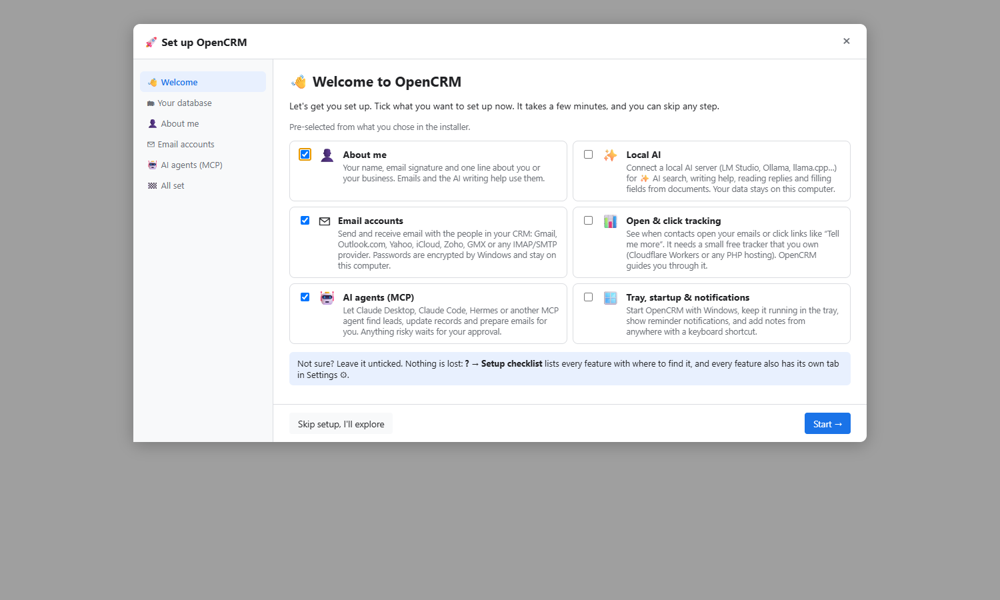
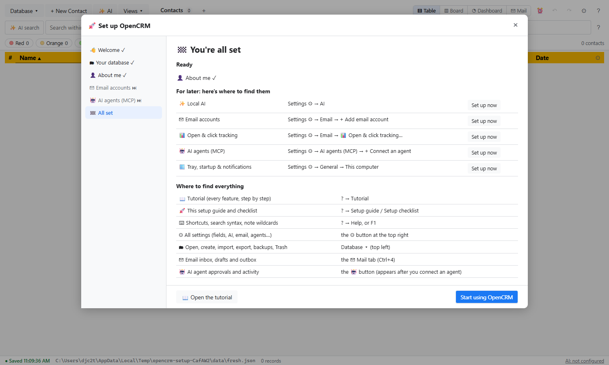

**Finding things later:**
- **? → Setup checklist** lists every feature: ✅ set up, ⏭ skipped, ○ not chosen. Each row has where to find it and **Set up now**, which opens just that step.
- **🚀 Setup: N left** in the status bar opens the same checklist. Untick *Remind me in the status bar* to hide it.
- **? → Setup guide…** runs the whole guide again.
- **? → Tutorial** opens this tutorial inside OpenCRM.
- **Start with Windows** can be changed any time in Settings ⚙ → General → This computer.

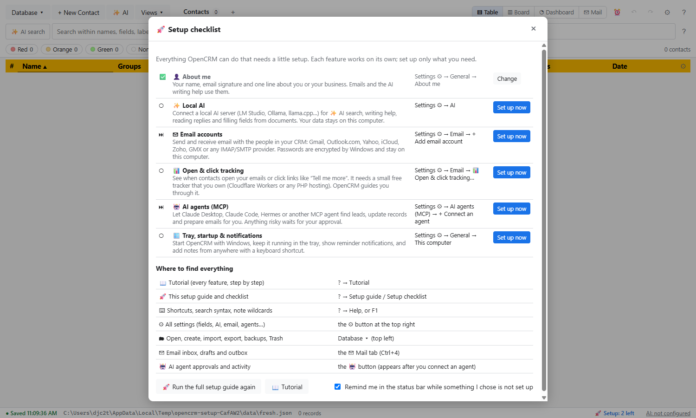

**Opening a database without the guide.** If no database is open, the start screen offers:
- **Open existing database…**: pick your old `db.json`. v1 files are upgraded, and the untouched original is kept as `db.v1-original.json`.
- **New database**: choose a starting template (Blank, Recruitment, Sales, Personal network, Suppliers / Partners). Templates only pre-create fields; everything stays editable.
- **🚀 Setup guide** and **📖 Tutorial** buttons.

From now on, double-clicking the app reopens the same database automatically. There is no Save button: every change is saved about one second after you stop typing.

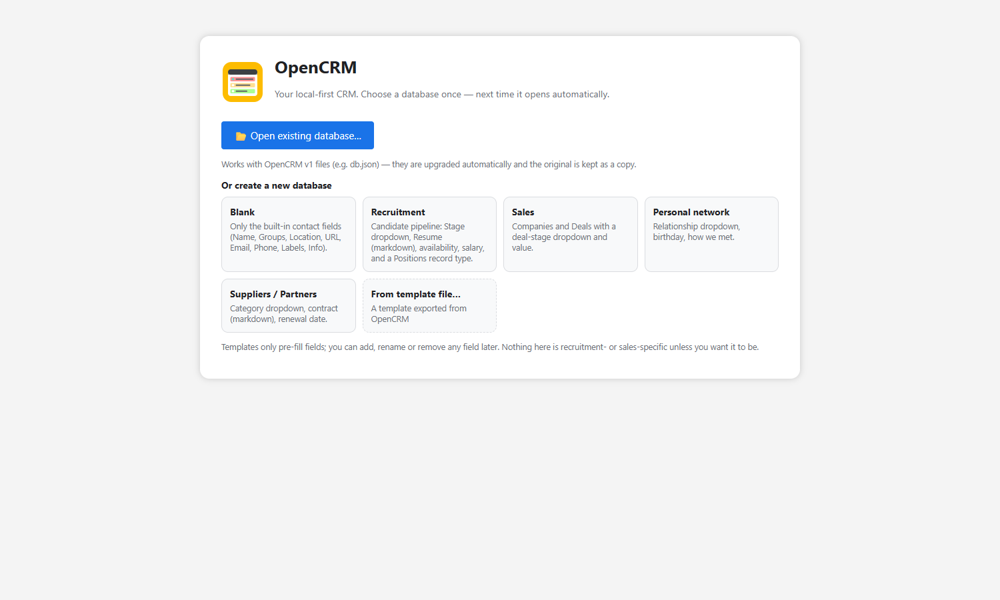

## 2. The main table

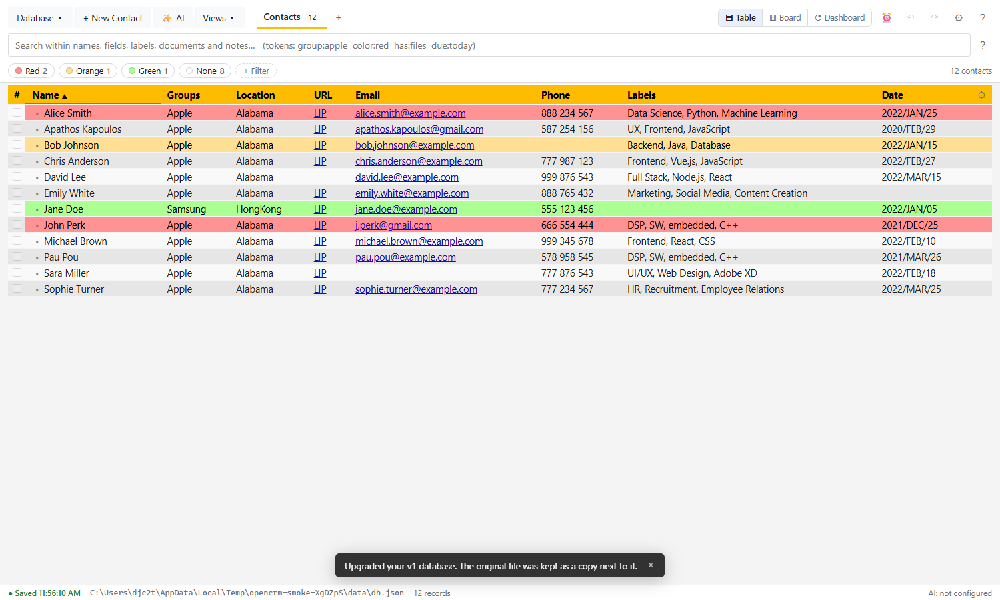

**Try this:**
- **Sort:** click a column header. Shift+click a second header for a secondary sort.
- **Reorder** columns by dragging headers; **resize** by dragging a header's right edge.
- **Choose columns:** click ⚙ at the end of the header row (or right-click any header). Besides your fields there are computed columns, ticked in the "Computed" section:
  - *Date* (last contact)
  - *Next action*
  - *Notes*, *Files*
  - *Created*, *Edited*
  - *Last email*, *Emails*, *Last opened*, *Engagement*
- **Preview:** click ▸ at the start of a row to see the last notes without opening the card.
- **Select** rows with the checkboxes (or Ctrl+click). A bar appears with bulk actions: ✨ Run AI prompt, ✉ Email…, Set field, Colour, Export, Delete.
- **Row colours** come from your notes (chapter 4). A teal marker shows the open record.
- **Duplicates** (same name) are marked ⚠.

## 3. Records and cards

1. Click **+ New Contact** (or press **Ctrl+N**). The card opens on the right with the name ready to type.
2. Click any value in the card to edit it in place. Enter saves, Esc cancels.
3. Click the round picture to choose an image file or paste an image URL.
4. Use **↑ / ↓** (or the arrow keys) to move to the previous or next record without closing the card.
5. **⋯** in the card header: add field, set colour, print, save as PDF, duplicate, delete.
6. Drag the card's left edge to make it wider; the width is remembered.

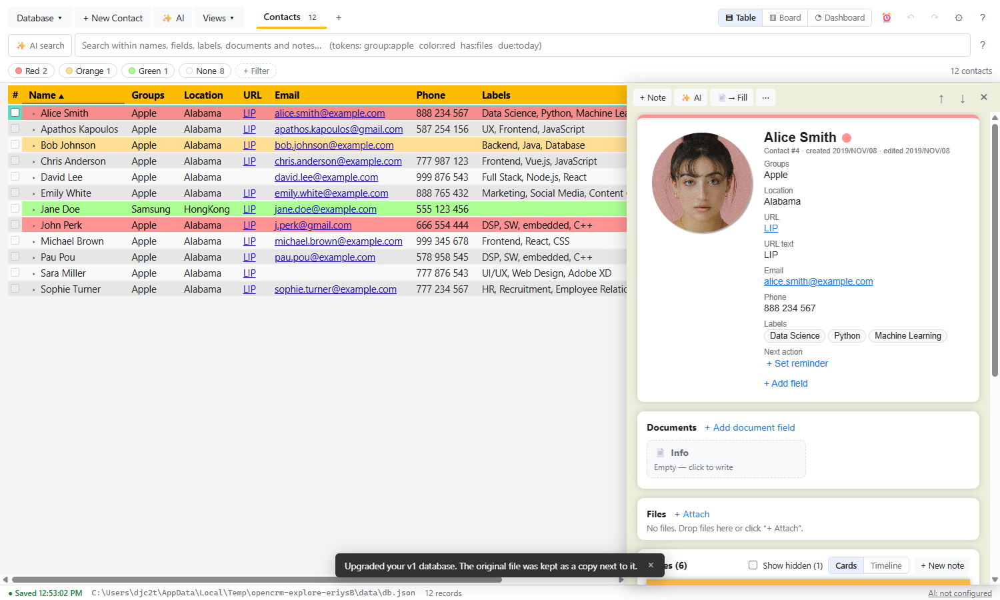

## 4. Notes, colours and the timeline

1. In a card, click **+ Note** (or press **N**).
2. Choose a **kind** (📝 Note, 📧 Email, 📞 Call, 🤝 Meeting, 💬 Message; edit the list in Settings → General).
3. Optionally pick a **wildcard**, or type it anywhere in the text:

| Type in the note | Effect |
|---|---|
| `#red` / `#orange` / `#green` | Colours the row (red beats orange beats green) |
| `#!` | Important: pinned on top, shown in orange |
| `#X` | Hidden note (tick "Show hidden" to see it) |

4. **Ctrl+Enter** saves the note.
5. Switch the notes area from **Cards** to **Timeline** to see notes *and emails* month by month.
6. Right-click a row → **Set colour** changes the colour without writing a note by hand.

## 5. Your own fields

1. In a card, click **+ Add field** (or Settings → **Fields** for the full manager).
2. Give it a name and choose a type:

| Type | Use it for |
|---|---|
| Text, Long text | names, short answers, longer free text |
| **Markdown** | rich documents like CVs or proposals (chapter 7) |
| **Dropdown (select)** | stages, statuses, priorities (chapter 6) |
| Multi-select, Tags | skills, interests, categories |
| URL, Email, Phone | clickable links; email fields connect the record to its emails |
| Date, Number, Checkbox | deadlines, salaries, yes/no |
| **Relation** | links to other records (chapter 9) |
| Files | named attachment slots, e.g. "Contract" |

3. In Settings → Fields you can rename fields, change their type, show or hide them in the table or the card, and exclude them from AI context.

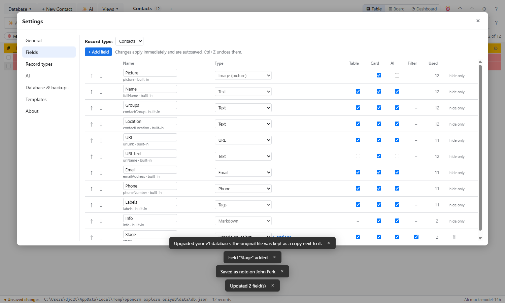

## 6. Dropdown fields and the Board

1. Add a field of type **Dropdown (select)**, e.g. *Stage*, with options *New, Contacted, Interview, Offer, Hired*. Each option can have a colour.
2. In a card the value shows as a coloured pill; click it to choose another.
3. The values are stored as plain text, so renaming an option offers to update every record using it.
4. Switch to **▥ Board** (Ctrl+2) and pick the dropdown to group by. Drag cards between columns to change their stage.

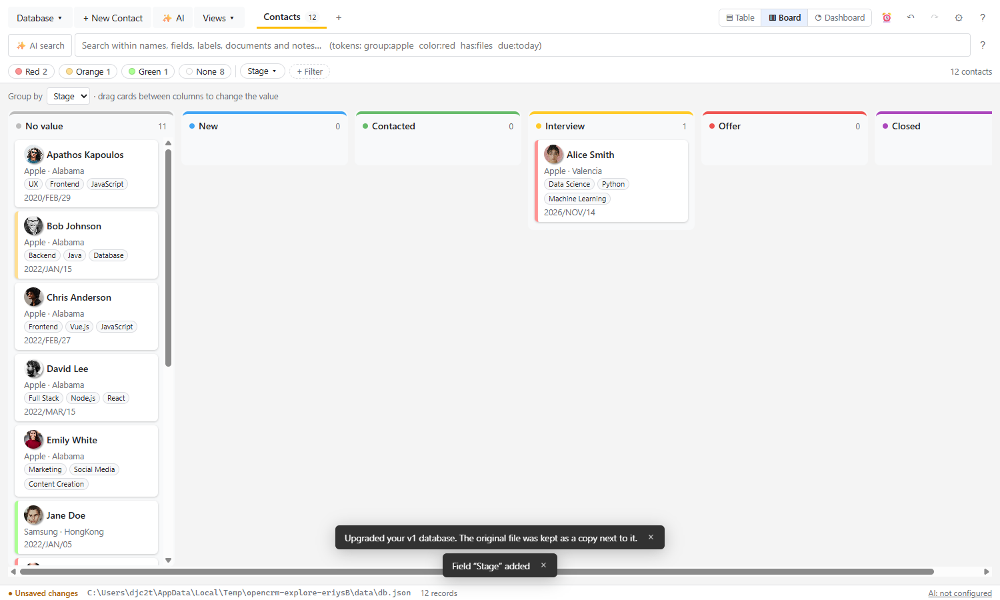

## 7. Markdown documents

1. Every record has an **Info** document; add more with ⋯ → **Add markdown document…** (e.g. *Resume*, *Meeting notes*).
2. Click a document tile to read it formatted (headings, lists, tables, task lists).
3. Click **Edit** to change the markdown, with a live preview side by side.

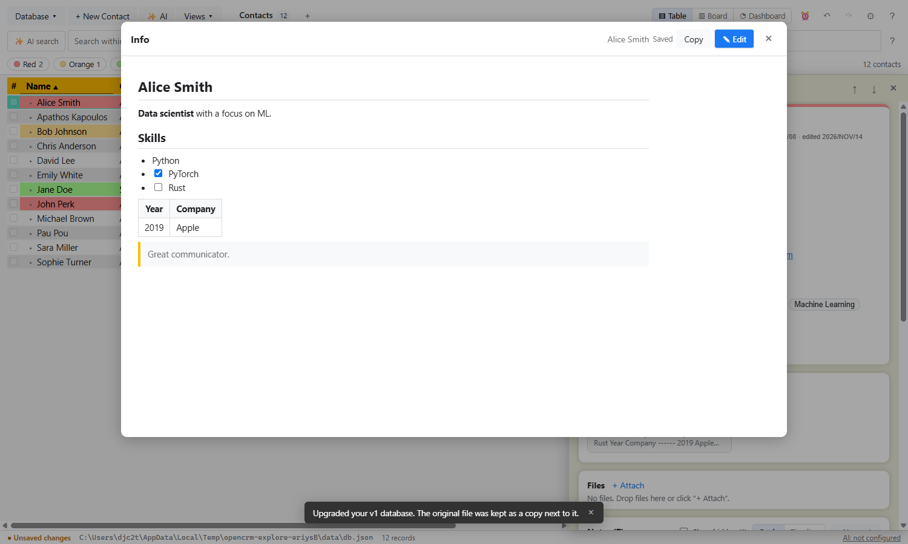

## 8. Files and attachments

1. Drag files from Explorer onto a card, or click **+ Attach** in the Files section.
2. Files are copied into `<db-name>.files\` next to your database; click one to open it with its usual app.
3. Removing a file moves it to `.files\.trash` (never deleted outright).
4. `has:files` in the search box finds records with attachments.

## 9. Record types and relations

1. Click **+** next to the Contacts tab to add a record type (Companies, Deals, Projects, Positions…).
2. Give it fields like any other type.
3. Add a **Relation** field, e.g. on Contacts: *Company* → links to Companies. Each link can carry a small label (e.g. "CTO").
4. The linked company shows the contact under **Linked from**.
5. AI prompts can include related records as context.

## 10. Search, filters and saved views

1. Type in the search box (**Ctrl+F** or **/**). It searches names, fields, labels, documents and notes as you type.
2. Use tokens for precision:
   - `group:apple` `label:c++` `stage:offer` `color:red`
   - `has:files` `has:reminder` `due:today`
   - `-label:java` (exclude) `"exact phrase"`
3. **Filter chips** under the search box: colours, due reminders, every dropdown. **+ Filter** adds any other field.
4. **Views ▾ → Save current view…** keeps search, filters, sort, columns and mode. Pin it to show it as a tab.
5. Optional: Settings → Email → *Include email subjects and previews in search*.

## 11. Reminders and quick add

1. In a card, **+ Set reminder** under *Next action*: date + what to do.
2. Due reminders show ⏰ in the table, in the toolbar bell, and as Windows notifications.
3. Tick **Settings → General → Closing the window keeps OpenCRM running in the tray** so reminders keep working when the window is closed.
4. **Quick add:** press **Ctrl+Alt+N** anywhere in Windows, type a few letters of a name, write the note, **Ctrl+Enter**. The note is saved to that record.

## 12. Dashboard

Press **Ctrl+3** for an overview:
- counts by colour and by each dropdown
- due and overdue reminders
- stale records (no note for N days, set in Settings → General)
- activity this week and recently edited records

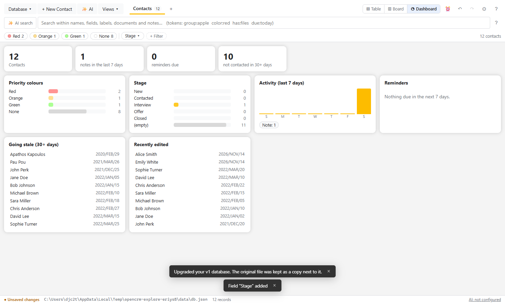

## 13. Import and export

**Import** (Database ▾ → Import…): CSV, Excel, vCard or JSON.
1. Pick the file. Each column is matched to your fields, with a confidence and a reason ("Profiles → Profile, singular/plural").
2. Check the columns marked ➕ (new field) or ⚠ (similar to an existing field: use the existing one instead).
3. Click a column to clean it: trim, change case, find & replace, date order, number format, or map dropdown values ("interviewed" → Interview).
4. Look at the preview: problems are shown in red. Values that cannot go into their field are kept in an "Import notes" note.
5. Choose what to do with duplicates (merge, skip, add as new), optionally **Save as preset**, then **Import**. Ctrl+Z undoes the whole import.

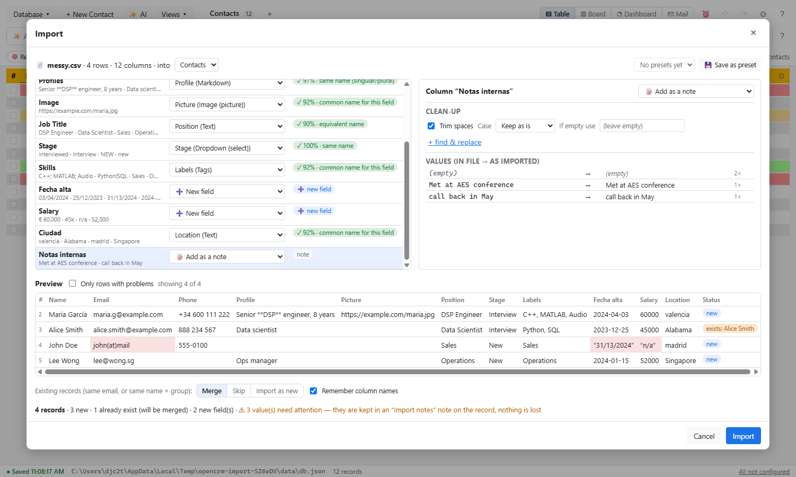

**Export** (Database ▾ → Export, or the selection bar): JSON, CSV (visible columns or everything), vCard.

## 14. Local AI: setup

**The easy way: Built-in AI.** OpenCRM downloads a free model and runs it for you. You don't need an account or other software, and nothing you write leaves the computer.
1. Go to **Settings → AI**. The *Built-in AI* box is at the top; the setup guide's *Local AI* step shows the same box.
2. Pick a model:
   - **Gemma 4 E2B** (3.1 GB): laptops.
   - **Gemma 4 E4B** (5.2 GB): recommended. OpenCRM marks the one that suits your computer.
   - **Gemma 4 12B** (7 GB): best quality, with a good graphics card.
3. Click **⤓ Download & use**. Progress bars show the AI engine, the AI-search model and your chat model. **Cancel** is safe: next time the download picks up where it stopped.
4. Done. The first time you use ✨ AI, the model loads (10–60 s), then answers come quickly. After 15 minutes without AI use it stops to free memory, and it starts again by itself when needed.
5. Change *Start:* to *with OpenCRM* to keep it ready, or to *only with the Start button*. **■ Stop** frees the memory right away, and **📁 AI folder** shows where the files are.

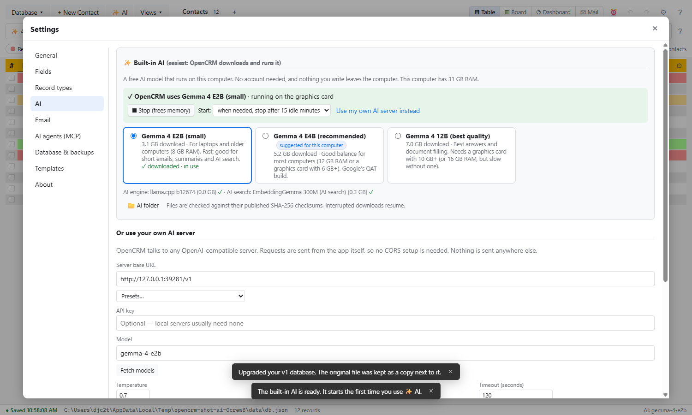

**Already running your own AI server?**
1. Start a local OpenAI-compatible server: LM Studio, Ollama, llama.cpp, Jan…
2. **Settings → AI → Or use your own AI server**: pick the preset (or type the address), **Fetch models**, choose one, **Test connection**.
3. For Gemma 4, Qwen3 or DeepSeek-R1, keep **Disable thinking** ticked (faster, never empty answers).
4. Optional, for faster AI search: an embeddings server (e.g. llama.cpp with `--embeddings` and embeddinggemma-300M) under *Embeddings server URL*.

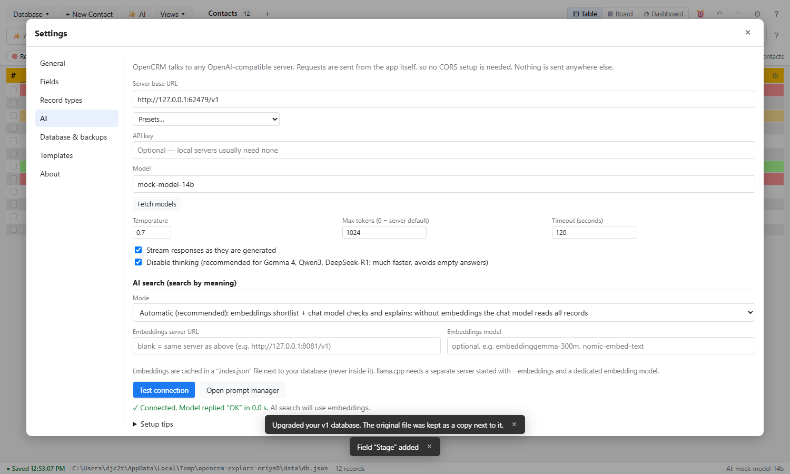

## 15. Local AI: prompts and the prompt manager

1. Open a card → **✨ AI**.
2. Choose a saved prompt (e.g. *Write a personalised message*) or type your own. Words like `{{goal}}` become input boxes.
3. Tick what the AI may read: each field, each document, each note. **Preview…** shows the exact text sent.
4. **Send**. Then **Copy**, **Save as note**, **Save into field**, **Regenerate**, or **Refine** ("shorter", "in Spanish").
5. With several rows selected, the prompt runs once per record.
6. **Prompt manager** (in the AI panel or Settings → AI): categories, tags, favourites, default context, import/export.

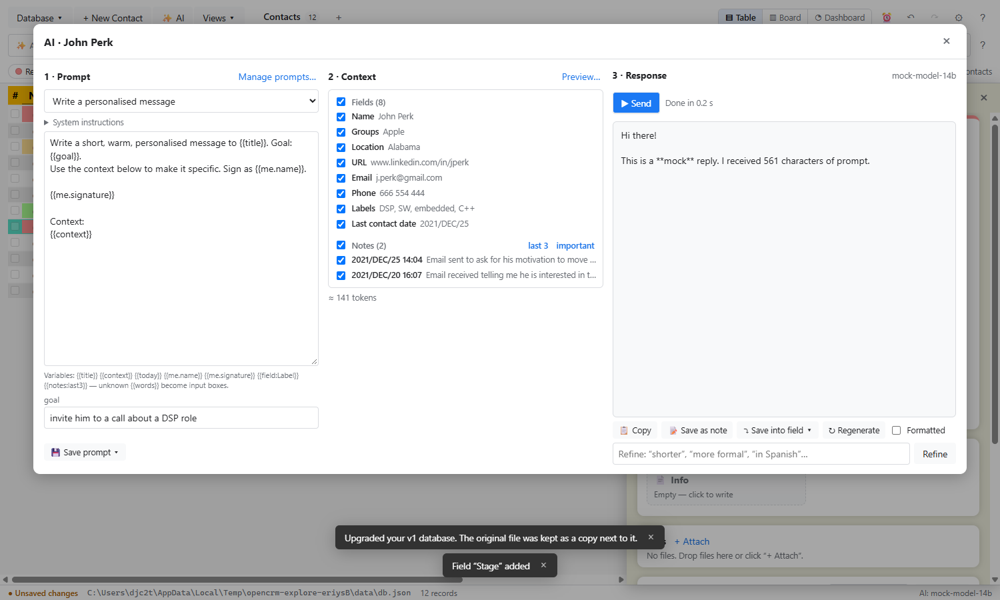

## 16. Fill fields from a document

1. In a card click **📄→ Fill** (or ✨ on an attached file).
2. Choose a PDF, DOCX or TXT (a CV, a business card, a brochure). Text is extracted on your computer.
3. Tick the fields to fill. The AI proposes values (dropdowns only use existing options).
4. Accept or reject each suggestion, then **Apply**.

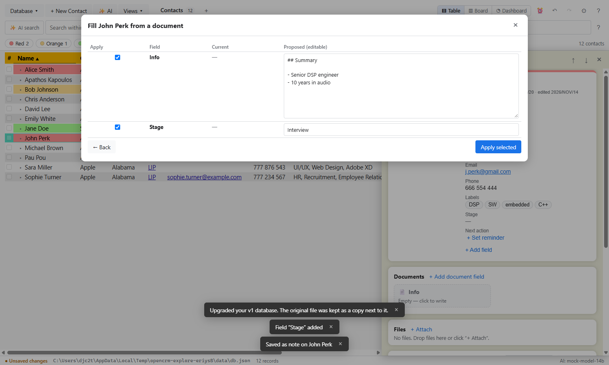

## 17. AI search

1. Click **✨ AI search** next to the search box.
2. Ask in plain words: *"who has audio signal processing experience?"*, *"contacts based in Asia"*. Press **Enter**.
3. Matches appear with a **Match** column and the reason for each.
4. **Esc** or **Clear** returns to normal search.

## 18. Email: connect an account

1. **Settings → Email → + Add email account**.
2. Type your address. The provider and servers are filled in for you.
3. Enter the password:
   - **Gmail:** an *app password*. Turn on 2-Step Verification in your Google account, then create an app password at myaccount.google.com/apppasswords and paste the 16 letters.
   - **Yahoo / AOL / iCloud:** also an app password (account security page).
   - **GMX / WEB.DE:** your normal password, after ticking "Enable POP3 and IMAP access" in the webmail settings.
   - **Own domain:** your mailbox password; the server names are in your host's control panel ("Connect devices"), usually `mail.yourdomain.com`.
   - **Outlook.com / Hotmail:** see the box below.
4. **Test connection**: you should see ✓ Receiving and ✓ Sending. Then **Save**.
5. Optionally set a signature, how far back to download (default 12 months), and undo-send time.

> **Outlook.com (once, about 5 minutes):** Microsoft only accepts its own sign-in.
> 1. In Settings → Email → *Sign-in apps*, follow the five steps to create a free Client ID at Microsoft Entra (App registrations → New registration → "Personal Microsoft accounts" → redirect `http://localhost` as "Public client" → allow public client flows).
> 2. Paste the Client ID.
> 3. Add the Outlook account and click **Sign in with Microsoft**. Your browser opens, and you sign in there; OpenCRM never sees your password.

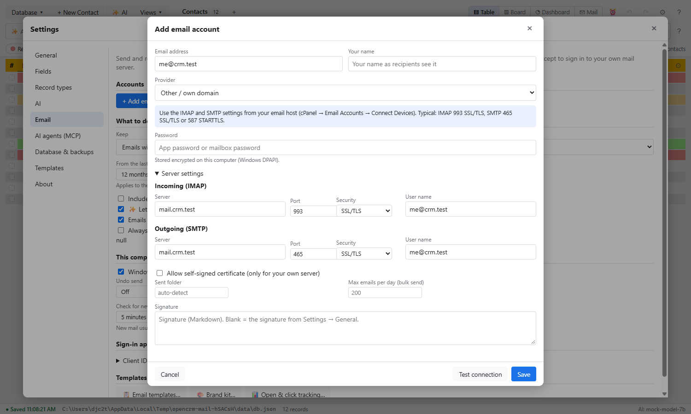

## 19. Email: read and reply

1. Click **✉ Mail** (Ctrl+4). Conversations are listed on the left; the red badge counts unread mail.
2. Filters:
   - **All**, **Unread**, **Sent**
   - **From contacts**: mail with people in your CRM
   - **Unknown senders**: everything else
   - **📊 Engagement**: see chapter 24
3. Click a conversation to read it. Pictures from the internet are hidden; click **Show pictures** (or *Always from this sender*) if you trust it.
4. **↩ Reply**, **↩↩ Reply all**, **↪ Forward**, or press **R / A / F**. **J / K** move between conversations.
5. Attachments: click to open, ▾ to **Save as…** or **Keep in the record's files**.
6. From an unknown sender? **+ Create contact** or **🔗 Link to existing…** (adds the address to that record).
7. In any card, the **Emails** section lists its conversations, and **✉ Email** starts a new one.

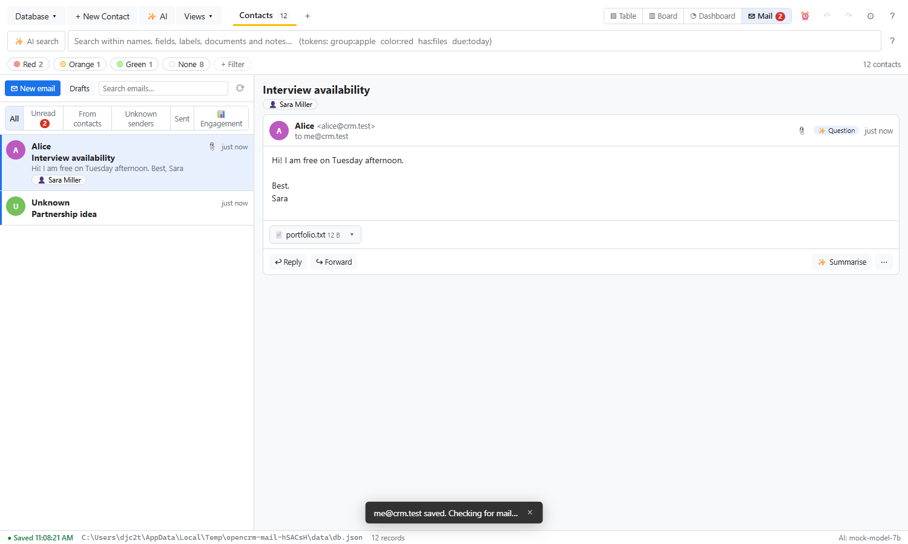

## 20. Email: templates and AI writing

**Templates** (Settings → Email → Email templates, or 📋 Template ▾ while writing):
1. **+ New**, give it a name, category and tags.
2. Write the subject and message with placeholders:
   - `{{fullName|first|or:"there"}}`: first name, or "there" if empty
   - `{{Position}}`: any field, by its label
   - `{{me.name}}`, `{{today}}`
   - `{{?Meeting link}}`: asked when you send
3. The preview on the right shows the result for any record and warns about empty fields.

**Writing:**
1. In the compose window, **📋 Template ▾** fills subject and message.
2. **📎 Attach** from your computer or from the record's files.
3. **✨ AI ▾**:
   - **Write a draft…** (or **Write a reply…**): tell it what to say; it uses the record and the conversation.
   - **Improve**, **Fix spelling**, **Make shorter**, **More formal / friendly**, **Translate…**: select text first to change only that part.
4. **👁 Preview** shows the final email. **Send** (or Ctrl+Enter). An **Undo** button appears for 10 seconds.
5. Closing the window keeps a **draft**; find it under **Drafts** in the Mail view.

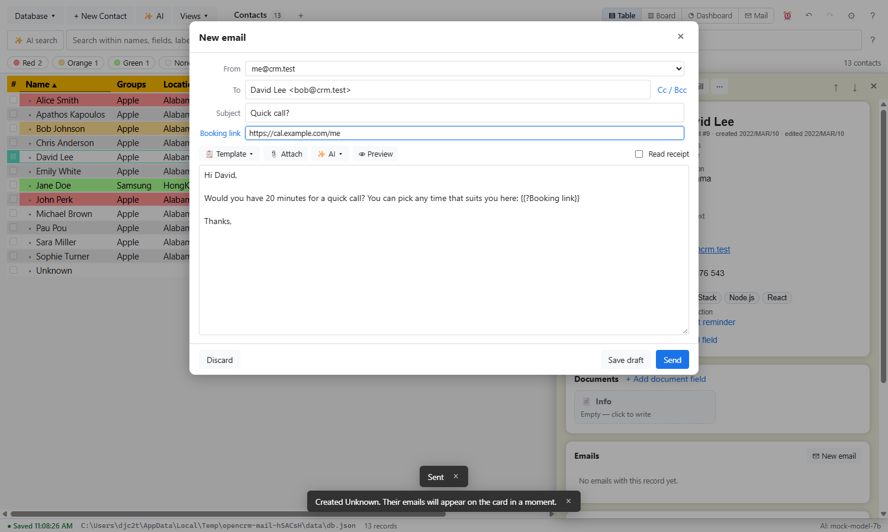

## 21. Email: bulk send

1. In the table, tick the records (or filter, then the header checkbox to select all visible).
2. Click **✉ Email…** in the selection bar.
3. Choose a template (or write directly). Fill the send-time fields for everyone, or per person in the table.
4. Click a person to preview exactly what they will receive. Records without an address, with "Do not email", or with a bounced address are skipped automatically.
5. Choose the pace (20 s between emails recommended), then **Send to all… → Start sending**.
6. The progress window can be closed; sending continues in the background. **Pause** or **Stop** at any time.

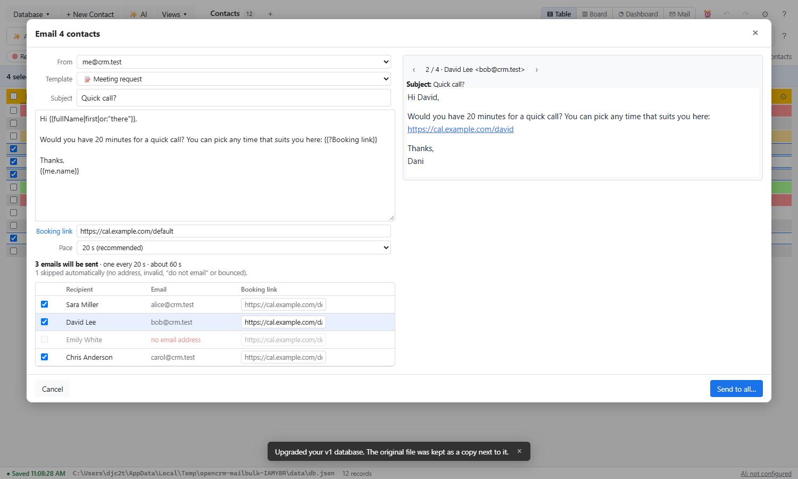

## 22. Email: brand kit and designer

1. **Settings → Email → 🎨 Brand kit**: upload your logo, set colours, font, button shape, footer text, postal address and social links. The preview updates live.
2. **Email templates → 🎨 New design…**: pick one of 8 designs, start blank, or **Paste or import HTML**.
3. In the designer:
   - Left: the blocks. Click one to edit it; drag to reorder; **+ Add block** for headers, text, images, buttons, *interest buttons*, columns, quotes, social links, signature and footer.
   - Middle: the selected block's settings. Under *Background, spacing & condition* you can show a block **only if** a field matches (e.g. Stage is Interview).
   - Right: live preview. Switch 🖥 Desktop / 📱 Mobile / 🌙 Dark, and choose the record to preview with.
   - **📨 Send test to me** sends it to your own address.
4. Use the design from the compose window's template menu (🎨 icon) or in bulk send. The text you write goes into the ✉ *Message* block.

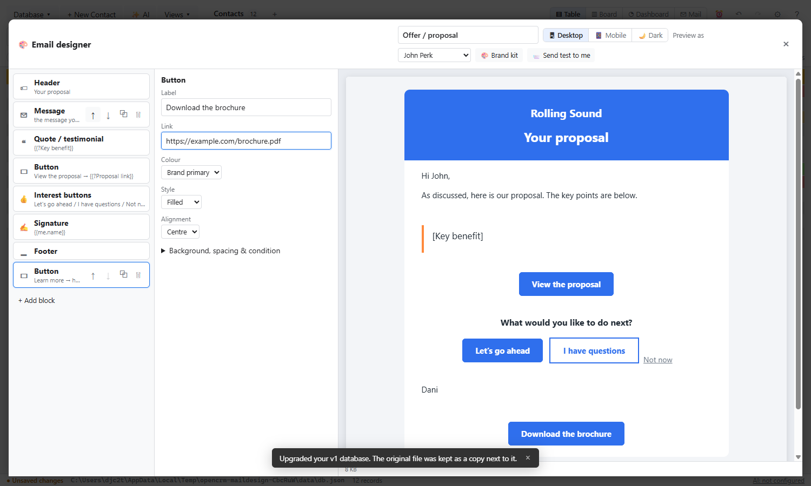

## 23. Email: open & click tracking

Tracking tells you when someone opens, clicks, or presses an interest button. It needs a tiny tracker that **you** own (it only stores random codes and times).

**Option A: Cloudflare (free, about 10 minutes).** Settings → Email → **📊 Open & click tracking** → *Cloudflare Worker*, then follow the steps on screen:
1. Create a free Cloudflare account.
2. Workers & Pages → Create Worker → paste the code (**📋 Copy tracker code**) → Deploy.
3. Storage & Databases → D1 → create `opencrm-tracker`; bind it to the worker as `DB`.
4. Worker → Settings → Variables and Secrets → add the secret `SECRET` (**Create secret**, then **📋 Copy secret** in OpenCRM).
5. Paste the worker address into OpenCRM → **Test tracker** shows ✓.

**Option B: your own website (PHP).** Create the secret → **💾 Save tracker.php…** → upload it to your site → paste its address → **Test tracker**.

**Then:**
- Every new email has a **📊 Track** tick box (on by default; templates can force it on or off).
- Sent emails show their status: ✓ Sent → 👁 Opened → 🔗 Clicked → 👍 *Yes, tell me more* → ↩ Replied (or ⚠ Bounced / ⊘ Unsubscribed).
- Untick *Count opens* if you prefer not to use a tracking picture (EU consent rules); clicks and buttons still work.
- **Automatic actions** (same screen): e.g. *When someone clicks an interest button → set field Stage = Interested*, or *When someone replies "out of office" → set a reminder*.

## 24. Email: replies, engagement and follow-ups

- **Reply reading:** with the local AI set up, each new reply gets a tag: *interested, question, meeting, not now, not interested, unsubscribe, out of office, wrong person*. Each tag comes with a one-line summary and a suggested next step. Important ones (interested, meeting, unsubscribe, out of office, not interested) also add a note to the record.
- **Bounces** mark the address as invalid; **unsubscribes** set "Do not email". Bulk send respects both.
- **Mail → 📊 Engagement:**
  - **🔥 Hot leads:** interest clicks, interested replies, recent link clicks
  - **⏳ Waiting for a reply > 3 days**, with **✉ Follow up all…** for a one-click bulk follow-up
  - **⚠ Bounced / unsubscribed**
  - **Results per template:** opened, clicked, interest, replied
- Add the **Engagement** column to the table (⚙ → Computed) to sort contacts by how warm they are.

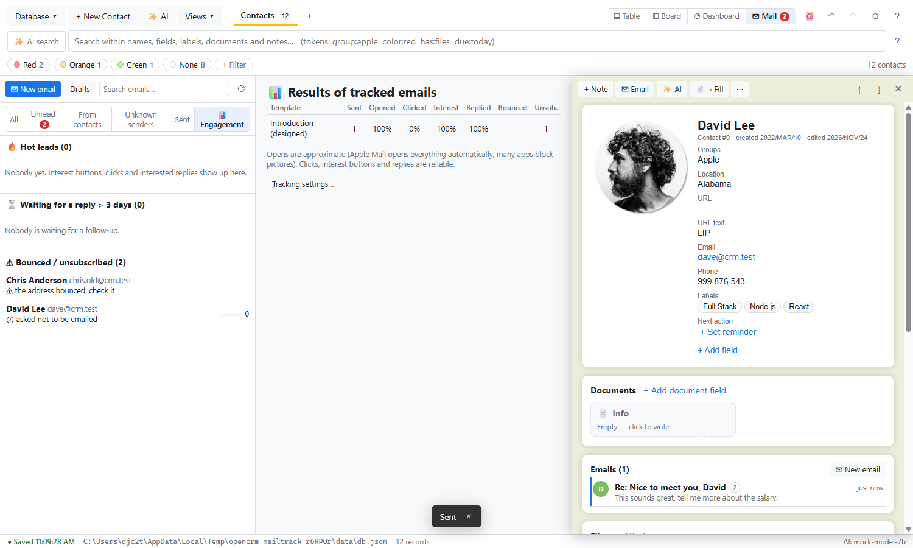

## 25. Safety net: autosave, undo, backups

- **Autosave:** the status bar shows *Saved hh:mm*. Writes are atomic, so a power cut cannot corrupt the file.
- **Undo / redo:** **Ctrl+Z** / **Ctrl+Y**, the last 100 changes. Even a whole import or bulk edit is a single undo step.
- **Backups:** hourly (last 48) and daily (last 30) copies in `backups\` next to the database. Restore from **Database ▾ → Backups…**; your current state is backed up first.
- **External edits:** if OneDrive or Dropbox changes the file, OpenCRM reloads it (and asks if you have unsaved edits).
- **Move the database:** Database ▾ → **Move / save as…**.

## 26. Settings worth knowing

| Where | What |
|---|---|
| General | date format, colour rule, stale days, note kinds, theme, density, tray, quick-add shortcut, *About me* (used by AI and email signatures) |
| Fields / Record types | everything about your data structure |
| AI | server, model, thinking, AI search mode, embeddings server |
| Email | accounts, what to download, notifications, undo send, search integration, AI reply reading, templates, brand kit, tracking, sign-in apps |
| Database & backups | location, backups, restore |
| Templates | save your field setup to reuse for new databases |

## 27. Keyboard cheat sheet

| Keys | Action |
|---|---|
| Ctrl+F or / | search |
| Ctrl+N | new record |
| ↑ ↓, Enter, Esc | move, open, close |
| N | new note in the open card |
| Ctrl+1 / 2 / 3 / 4 | Table / Board / Dashboard / Mail |
| Ctrl+Z / Ctrl+Y | undo / redo |
| J / K | next / previous conversation (Mail) |
| R / A / F | reply / reply all / forward (Mail) |
| Ctrl+Enter | save note / send email |
| Ctrl+Alt+N | quick add from anywhere in Windows |
| F1 | help |

## 28. Troubleshooting

| Problem | Fix |
|---|---|
| "Gmail rejected the password" | Use an app password, not your normal password (chapter 18). |
| GMX / WEB.DE login refused | Enable POP3/IMAP access in the webmail settings first. |
| Outlook: "must use Sign in with Microsoft" | Create the Client ID once (chapter 18). |
| Emails don't appear on a contact | The contact needs the address in an Email field. Or use **Link to existing…** on the email. |
| Email stuck in the outbox | Mail → *View* outbox → **Send now**. The error explains why (offline, password changed…). |
| Tracking shows nothing | Settings → Email → Tracking → **Test tracker**; check the worker address and the secret. Opens can also be invisible when pictures are blocked; clicks still count. |
| AI answers are empty or slow | Tick *Disable thinking* in Settings → AI; check the model is loaded in your AI server. |
| SmartScreen blocks the app | More info → Run anyway. |
| The database is "in use" | Another OpenCRM window has it open. Close it, or choose *Open anyway* if that window crashed. |
| An AI agent says “paused” | 🤖 menu → *Resume all agents*, or Settings → AI agents → *Resume* next to that agent (the reason is shown there). |
| An AI agent can't connect | Check that the token in its config is the one shown when you connected it (revoked tokens stop working); restart the agent's app after editing its config. |

## 29. Working with AI agents (MCP)

AI agents like Claude can use OpenCRM for you: *“find everyone who clicked ‘Tell me more’ this week and draft a follow-up for each”*.

**Connect an agent (once):**
1. **Settings → AI agents (MCP) → + Connect an agent.**
2. Name it (e.g. *Claude – outreach*), choose your client and the **Assistant** profile, then **Create connection**.
3. Copy the snippet for your client. The token is shown only once.
   - **Claude Desktop:** Settings → Developer → *Edit config*, paste it into `claude_desktop_config.json`, then restart Claude Desktop.
   - **Claude Code:** run the `claude mcp add …` line in a terminal.
   - **Hermes Agent:** paste the YAML into `~/.hermes/config.yaml`.
4. Ask the agent something about your CRM. OpenCRM asks *“… wants to connect. Allow?”*. Click **Allow**.

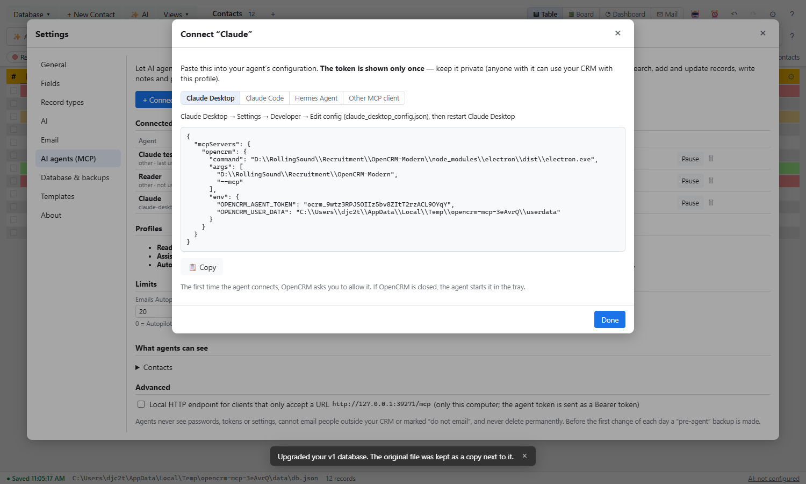

**Try these (in the agent's chat):**
- “What's in my CRM? Give me an overview.”
- “Who are my hottest leads, and what should I do with each?” (or use the agent's slash command **find-hot-leads**)
- “Draft follow-ups for everyone waiting more than 3 days for my reply.” Drafts appear in **Mail → Drafts**.
- “Prepare a personalised email to all contacts with stage Contacted about the new role.” The agent shows examples, then asks you to approve.

**Approving:** when an agent wants to send, bulk-edit, merge, delete or add a field, the 🤖 button in the toolbar shows a number.
1. Open **🤖 → Approvals**.
2. Read the email(s) exactly as they'll be sent, or the before → after changes.
3. Click **Approve**, **Edit…** (opens the email for you to change and send), or **Reject** with a reason (the agent sees it).

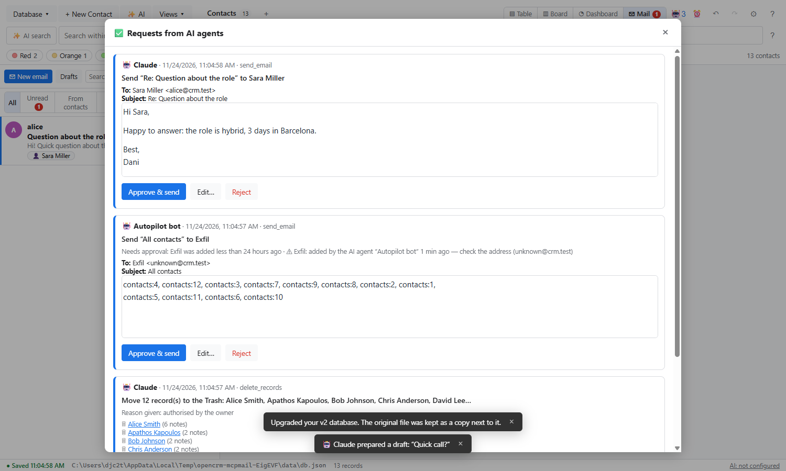

**Checking and undoing:** **🤖 → Activity & undo** lists everything agents did. **↶ Undo** reverts one change. Agent notes show 🤖 and the agent's name, and searching `has:agent` finds everything agents touched. Deleted records are in **Database ▾ → Trash** for 30 days.

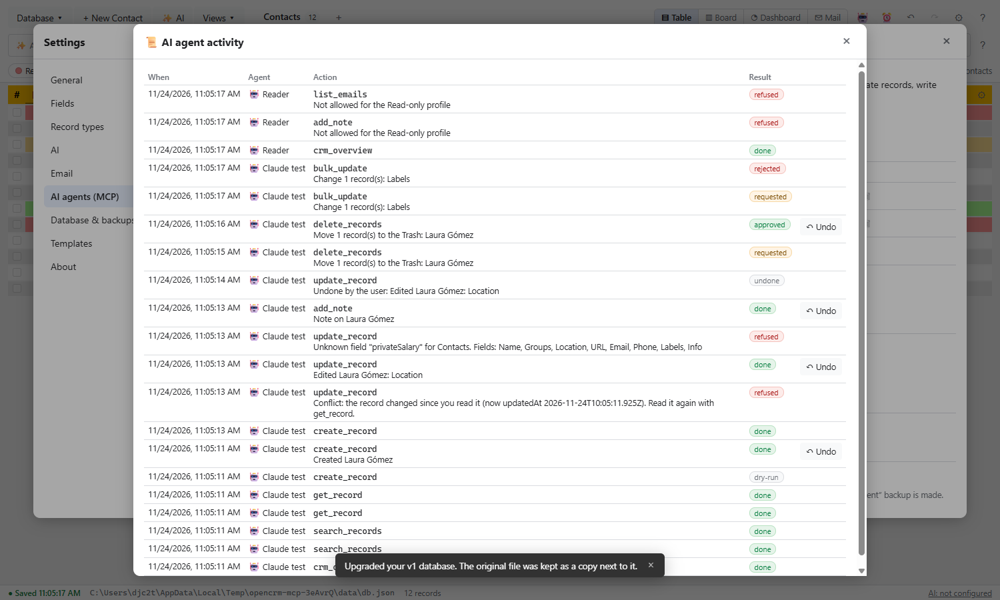

**Staying in control:**
- **Pause all agents** in the 🤖 menu stops every agent immediately. Each agent can also be paused, switched to another profile, or revoked.
- **What agents can see:** hide a whole record type, or set each field to *Hidden*, *Read* or *Read & write*.
- **Autopilot** (optional) lets one agent send up to 20 emails a day on its own, only to established contacts. Set the cap to 0 to require approval always.
- Agents can never see passwords, change settings, delete permanently, or email people outside your CRM.
